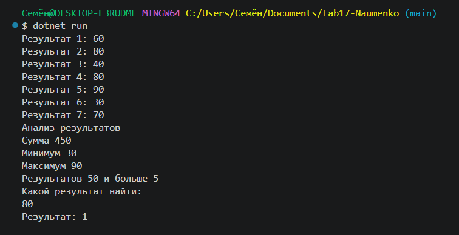

# Практическая работа №17

Автор: Семён Науменко
Группа: ИСП-251

## Тема

Алгоритмы обработки массивов.

## Что реализовано

- сумма элементов;
- подсчёт элементов по условию;
- минимум и максимум;
- линейный поиск;
- поиск первого индекса.

## Короткие ответы

1. Почему максимум нельзя всегда начинать с `0`?

Ответ: потому, что программа выведет неправильный результат, если числа в массиве отрицательные

2. Что означает `-1` после поиска индекса?

Ответ: То, что нужное число не было найдено

3. Чем сумма отличается от подсчёта элементов?

Ответ: Сумма - сложение всех элементов массива, а подсчёт - количество элементов

## Результат

